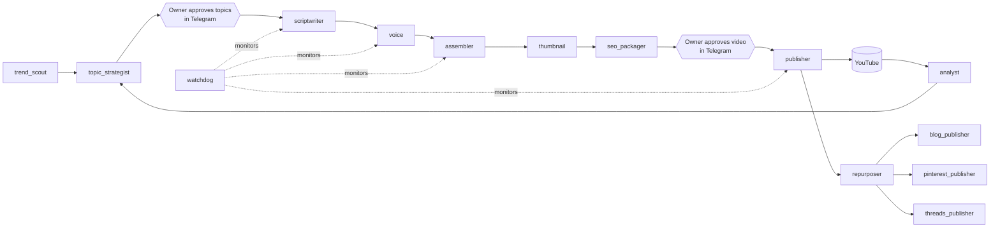

# Content Factory

A YouTube channel about PC gaming and desk setups that is produced by a pipeline of workers. The owner's only job is a weekly Telegram session to approve topics and finished videos.

Status: built and deployed on a VPS. The pipeline runs from trend research to a rendered, reviewed video, and a test upload to YouTube went through. The 7-day hands-off run is waiting on YouTube, Pinterest and Cloudflare API access.

## Problem
A niche channel needs about two long videos and seven shorts a week, plus blog posts and pins, to grow. Done by hand, that's a full-time job.
Content Factory turns it into a pipeline where a person only makes the editorial calls: which topics to cover, and whether a video is good enough to publish.

## What it does
- Scouts trends from RSS feeds and proposes a weekly topic plan
- Writes scripts, voices them, assembles video from footage, makes thumbnails and SEO metadata
- Publishes into scheduled slots, then turns each video into a blog article, Pinterest pins and Threads posts
- Sends a Sunday digest to Telegram; approve, reject or redirect a topic or a video with one button
- Records the cost of every API call, alerts above $5 a day, and has kill switches per format

## Screenshots / demo



## How it's built
- Python 3.12, 14 workers on one VPS (Docker, systemd), scheduled with APScheduler
- Each video moves through statuses in Postgres (Supabase); a worker picks up items in its status, so any step retries on its own
- Claude for scripts and topic strategy, ElevenLabs for voice, fal.ai for generated images and clips, Creatomate for assembly, Cloudflare R2 for media, Astro blog on Cloudflare Pages
- Telegram bot (aiogram) is the only interface for the owner: review cards, digest, budget, kill switches
- Built with Claude Code from a single build spec ([CONTENT_FACTORY_BUILD_PLAN.md](CONTENT_FACTORY_BUILD_PLAN.md)) and a task list; 200+ tests

## Run locally
```bash
cp .env.example .env    # keys for the services above
make test
docker compose up -d
```
Deploying to a VPS: [docs/RUNBOOK.md](docs/RUNBOOK.md).
